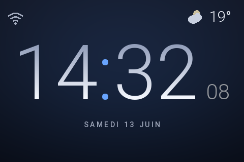
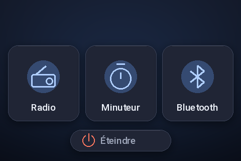
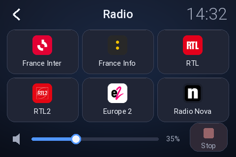
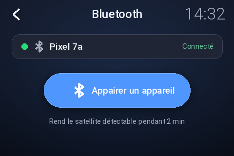

# Voice Satellite — Raspberry Pi 4

A fully local, self-hosted voice assistant built from parts on a Raspberry Pi 4,
integrated with [Home Assistant](https://www.home-assistant.io/) through the
[linux-voice-assistant](https://github.com/OHF-Voice/linux-voice-assistant) (LVA)
runtime. It listens, answers, runs the house, plays radio, keeps timers, and
doubles as a Bluetooth speaker — in a 3D-printed case with a 4" touchscreen.

No cloud, no subscriptions. Whisper (STT), Ollama (LLM) and Piper (TTS) all run
on local hardware; nothing leaves the LAN.

| Ambient clock | Menu | Radio | Bluetooth |
|:---:|:---:|:---:|:---:|
|  |  |  |  |

---

## Hardware

| Component | Module | Interface | Notes |
|-----------|--------|-----------|-------|
| Main board | Raspberry Pi 4 | — | Raspberry Pi OS Lite 64-bit (Debian 13 trixie) |
| Microphone | INMP441 (I2S MEMS) | I2S — GPIO18/19/20 | 48 kHz, S32_LE stereo |
| Amplifier + speaker | MAX98357A + 3 W 4 Ω | I2S — GPIO18/19/21 | shares BCLK/LRCLK with the mic |
| LED strip | WS2812B, **3 LEDs** | PWM — GPIO12 | DMA channel 5, 5 V, 300 Ω series |
| Display | **ST7796S 4.0" 480×320 landscape** | SPI0 @ 40 MHz | manual CS on GPIO8, DC 24, RST 25, backlight 23 |
| Touch | XPT2046 (on the display module) | SPI0 CE1 — GPIO7 | pen IRQ GPIO22 |

Everything is soldered onto a **proto hat** (no breadboard) — that is what makes
40 MHz SPI reliable. See [WIRING.md](WIRING.md) for the pinout and
[PROTO_HAT.md](PROTO_HAT.md) for the board layout.

> **Display history:** the satellite originally used a GC9A01 1.28" round
> 240×240 panel at 20 MHz. It was replaced by the ST7796S touchscreen in 2026;
> some renders in `case/` and the old `src/display/ui.py` still date from that era.

### Enclosure

3D-printed, designed in OpenSCAD under [`case/`](case/).

- **v5 — printed and in service.** Shell + bottom plate (7 screws), LED diffuser
  screwed from the inside into heat-set inserts, and a printed clamp frame that
  holds the LCD flat against the inner top face.
  Parts: `hub_case_v5_shell.stl`, `_plate.stl`, `_front_plate.stl`, `_lcd_clamp.stl`.
- **v6 — designed, not printed.** Same silhouette, split along a plane parallel
  to the sloped top face: a lid that prints face-down and a tub with an
  integrated floor, so the viewport, clamp bosses and mic pocket need **zero
  supports**. Service is two rear screws instead of seven bottom ones.

---

## Software

### On the Pi (`pi-satellite`)

| Layer | Tool |
|-------|------|
| Voice runtime | linux-voice-assistant (Docker, `network_mode: host`, privileged) |
| Wake word | microWakeWord, on-device — currently **"Okay Nabu"** |
| Audio | PipeWire / PipeWire-pulse over ALSA `googlevoicehat-soundcard` |
| LEDs | [rpi_ws281x](https://github.com/rpi-ws281x/rpi-ws281x-python) |
| Display | custom ST7796S SPI driver + Pillow render loop (`src/display/`) |
| Touch | custom XPT2046 driver with affine calibration |
| Media | mpv (built into LVA) |
| Bluetooth | BlueZ + `libspa-0.2-bluetooth` (A2DP sink into PipeWire) |

LVA reaches HA over the **ESPHome API on port 6053** (not Wyoming), discovered
via Zeroconf.

### On the home server (`dd-ha`)

| Layer | Tool |
|-------|------|
| Orchestration | Home Assistant (Assist pipelines) |
| Speech-to-text | faster-whisper (add-on) |
| LLM | Ollama — `gemma4:12b` on `dd-ai.home:11434` (RTX 3060 LXC) |
| Text-to-speech | Piper (`fr_FR-siwis-medium`) |
| Media | Music Assistant — owns the satellite speaker's queue |

---

## Architecture

```
   HA (dd-ha) ──ESPHome API :6053── LVA container ──┐
        │                                           │ docker logs (Python SDK)
        │ REST / MQTT                                ▼
        │                                    /tmp/va_state ──► LED daemon ──► WS2812B
        │                                          │
        └──────── HA context poll (~5 s) ──► Display daemon ──► ST7796S 480×320
                                                   ▲
                                              XPT2046 touch
```

- **State IPC** — the LED daemon tails the container's logs and writes the
  current state (idle / listening / processing / speaking / error) to
  `/tmp/va_state`; the display daemon reads it every frame.
- **Rendering** — the UI controller draws a full 480×320 frame, the daemon diffs
  it against what is on the panel and pushes only the changed rectangle over SPI.
  Idle costs almost nothing (~8 % of one core, down from 98 % before dirty-rects).
- **Bluetooth IPC** — `voice-bt.service` runs bluetoothctl and writes
  `/tmp/va_bt_status.json`; the display reads it and asks for pairing through
  `/tmp/va_bt_cmd`. The display process never forks (it would race SPI DMA).

---

## What it does

- **Voice** — wake word → local STT → LLM/intents → Piper reply, entirely on-LAN.
- **Touch UI** — a calm full-bleed clock; tap for a three-tile menu (Radio ·
  Minuteur · Bluetooth) plus power-off. Radio drives 6 stations through Music
  Assistant, timers use the same native intents as voice, and the home screen
  shows pills for what is running (with a stop button while the radio plays).
- **Night dimming** — the backlight follows HA's brightness scaled by time of
  day: full by day, 35 % from 22:00 to 07:00, ramped over 30 min, restored to
  full for 25 s by a touch.
- **Bluetooth speaker** — pair a phone from the touchscreen; audio mixes through
  PipeWire to the I2S amp. Works with no Wi-Fi and no HA, for portable use.
- **Display tunables in HA** — brightness, contrast, gamma preset and power are
  exposed over MQTT discovery by `voice-display-control.service`.

---

## Services

| Service | User | Purpose |
|---------|------|---------|
| `lva.service` | dd | LVA Docker container (`docker compose up` in `/home/dd/lva/`) |
| `voice-leds.service` | root | LED daemon — Docker log stream → ring animation |
| `voice-display.service` | root | Display render loop (SPI/GPIO need root) |
| `voice-display-control.service` | dd | MQTT bridge → display tunables in HA |
| `voice-bt.service` | dd | Bluetooth status/command bridge for the touch UI |
| `bt-agent.service` | root | Headless Just-Works pairing agent |

---

## Getting started

### 1. Wire it

Follow [WIRING.md](WIRING.md) — prototype on a breadboard (cap SPI at 20 MHz
there), then move to the proto hat for 40 MHz.

### 2. OS + packages

```bash
sudo apt update && sudo apt install -y \
    git python3-pip python3-venv pipewire pipewire-alsa pipewire-pulse \
    mpv python3-docker bluez-tools libspa-0.2-bluetooth
sudo pip3 install rpi_ws281x spidev RPi.GPIO pillow numpy paho-mqtt \
    --break-system-packages
```

### 3. Enable the interfaces

`/boot/firmware/config.txt` (verified working):

```ini
# I2S — full-duplex: INMP441 capture + MAX98357A playback
dtparam=i2s=on
dtoverlay=googlevoicehat-soundcard

# SPI — ST7796S display + XPT2046 touch
dtparam=spi=on

# Disable analog audio (I2S instead)
dtparam=audio=off
```

Reboot; audio appears as ALSA card 0 at 48 kHz / 32-bit stereo.

### 4. Bluetooth (optional)

```bash
sudo cp wireplumber/51-headless-bluez.conf /etc/wireplumber/wireplumber.conf.d/
```

Without this WirePlumber keeps seat-monitoring on, and a headless session has no
logind seat — so no A2DP sink is ever registered and phones fail to pair.

### 5. Services

```bash
sudo cp systemd/*.service /etc/systemd/system/
sudo systemctl daemon-reload
sudo systemctl enable --now lva voice-leds voice-display \
    voice-display-control voice-bt bt-agent
```

### 6. Calibrate the touchscreen

```bash
sudo systemctl stop voice-display
sudo python3 src/display/calibrate.py     # tap the 4 corners
sudo systemctl start voice-display
```

---

## Deploying changes

```bash
rsync -av src/ dd@pi-satellite:/home/dd/dev/voice-assistant/src/
ssh dd@pi-satellite "sudo systemctl restart voice-display.service"
```

Iterate on the UI without touching the Pi — `src/display/shot.py` renders every
screen to PNG headlessly:

```bash
python3 src/display/shot.py /tmp/shots
```

---

## Project structure

```
satellite/
├── README.md              — this file
├── CLAUDE.md              — full technical context (decisions, gotchas, status)
├── WIRING.md              — wiring diagram + GPIO pinout
├── PROTO_HAT.md           — soldered hat layout
├── WAKEWORD_TRAINING.md   — custom microWakeWord models
├── case/                  — OpenSCAD enclosure (v5 in service, v6 designed)
├── docs/ui/               — UI screenshots (generated by shot.py)
├── wireplumber/           — headless BlueZ drop-in
├── wakeword_training/     — microWakeWord training scripts
├── systemd/               — service units
└── src/
    ├── config.py          — GPIO / LED / display / touch constants, states
    ├── ha_context.py      — HA read path (media, timers, volume, weather)
    ├── leds/              — ring wrapper, animations, log-tailing daemon
    └── display/
        ├── driver.py      — ST7796S SPI driver (blit_frame / blit_rect)
        ├── theme.py       — palette, fonts, card primitive, RGB565
        ├── touch.py       — XPT2046 driver (edge-triggered taps)
        ├── app.py         — UI controller + all screens
        ├── daemon.py      — render loop, dirty-rect blit, night dimming
        ├── ha_actions.py  — HA service calls (radio / volume / timers)
        ├── bt_actions.py  / bt_bridge.py — Bluetooth UI ↔ bluetoothctl
        ├── control.py     — MQTT bridge for display tunables
        ├── calibrate.py   — touch calibration
        ├── shot.py        — headless PNG preview of every screen
        └── ui.py, display_ui.py — ⚠ stale round-display renderers, unused
```

---

## Hardware gotchas

> **SPI chunks ≤ 64 bytes.** Larger transfers hit BCM2835 SPI DMA, which
> conflicts with I2S PCM DMA while audio is open → `TimeoutError: [Errno 110]`.
>
> **Never toggle CS between pixel chunks** — it resets the ST7796S write-address
> counter. `spi.no_cs = True`, CS held low for the whole frame.
>
> **No `subprocess.Popen` in the display process** — forks race SPI DMA. Shell
> out through a bridge service and a file, as the Bluetooth path does.
>
> **WS2812B on DMA channel 5**, GPIO12 (PWM0). Channel 10 lights only one LED.
>
> **Re-pairing a bonded phone fails** with a passkey error — `bluetoothctl
> remove <mac>` and forget on the phone, then pair fresh.
>
> **After `docker rm -f lva`** the wake word resets to a default — re-select
> "Okay Nabu" on `select.rpi_satellite_mot_d_activation`.

---

## Status

- [x] Audio pipeline (INMP441 → PipeWire → MAX98357A)
- [x] LED state machine
- [x] ST7796S display + dirty-rectangle rendering (idle CPU 98 % → ~8 %)
- [x] XPT2046 touch driver, calibration, full touch UI
- [x] Radio (6 stations via Music Assistant), timers, volume
- [x] Bluetooth A2DP speaker mode with touch pairing
- [x] Display tunables in HA over MQTT + automatic night dimming
- [x] 3D-printed case (v5 in service)
- [ ] Delete the stale round-display renderers (`ui.py`, `display_ui.py`, and
      `display.zip` left on the Pi)
- [ ] Print the v6 case

---

## References

- [OHF-Voice/linux-voice-assistant](https://github.com/OHF-Voice/linux-voice-assistant)
- [INMP441 datasheet](https://invensense.tdk.com/wp-content/uploads/2015/02/INMP441.pdf)
- [MAX98357A datasheet](https://www.analog.com/media/en/technical-documentation/data-sheets/MAX98357A-MAX98357B.pdf)
- [rpi_ws281x](https://github.com/rpi-ws281x/rpi-ws281x-python)
- [RPi GPIO pinout](https://pinout.xyz)
